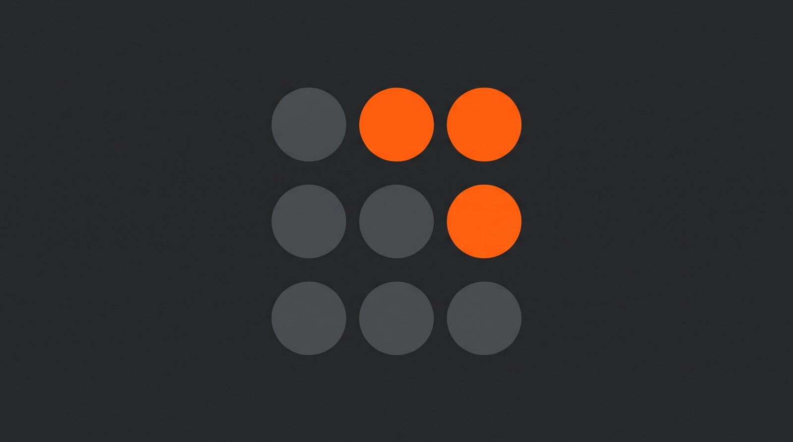

# Dott.it

<p align="center">
  
</p>

Teacher product spinoff from Dott.it — orange-led brand, free-tier stack (Vercel Hobby + Neon Free).

## Docs

| Doc | Contents |
|---|---|
| [TECHNICAL.md](./TECHNICAL.md) | Scope, stack, OAuth model, reuse from Dott.it, free-tier limits |
| [STRATEGY.md](./STRATEGY.md) | Context, diagnosis, brand, operating model |
| [DOMAINS.md](./DOMAINS.md) | Product / GitHub naming |

## Stack

- Next.js (App Router) + pnpm
- Dual Prisma schemas: `prisma/user` + `prisma/assessment` (multi-tenant)
- Auth: NextAuth (credentials + Google OAuth)
- Hosting target: Vercel Hobby; DB: Neon Free (empty — migrate only, no Dott.it data)

## Local setup

```bash
pnpm install
cp env.example .env.local
# Fill DATABASE_URL, USER_DATABASE, DIRECT_URL, NEXTAUTH_SECRET
pnpm prisma migrate deploy --schema=prisma/user/schema.prisma
pnpm prisma migrate deploy --schema=prisma/assessment/schema.prisma
pnpm dev
```

## Scripts

- `pnpm dev` — local server
- `pnpm lint` — ESLint
- `pnpm test:unit` — Jest + node:test suite
- `pnpm build` — prisma generate + Next build

DB seed scripts from Dott.it were **not** copied. Start from empty Neon databases.

## Status

Bootstrap from `dott-it-workspace` (structure + app code). Per-teacher OAuth, AI/Spotlight/digitize pruning, and real Vercel/Neon wiring come next.
