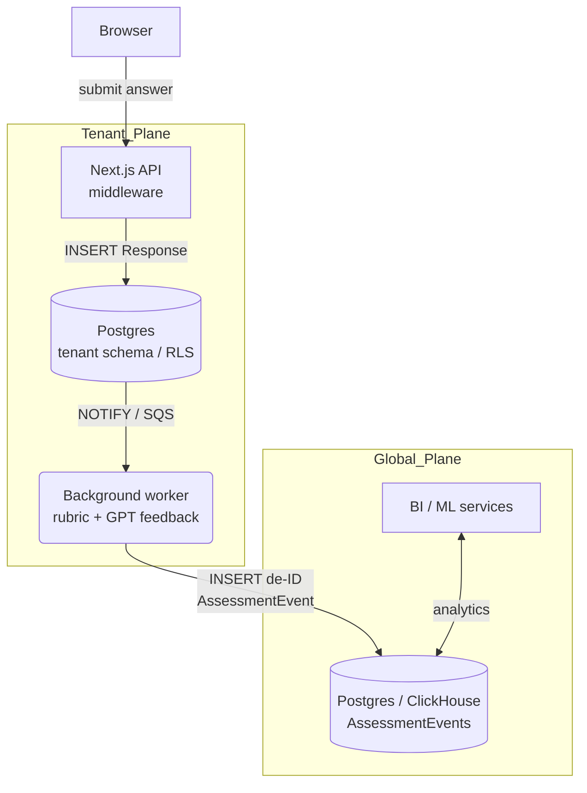

# Eddo Learning Workspace – Project Documentation

(v0.9 – June 19 2025)

---

## 1. Purpose

Eddo Learning Workspace is a multi-tenant web application that lets districts run AI-powered assessments while protecting personally identifiable information (PII).

Key goals:
- ✅ Isolate every tenant’s accounts & raw student data
- ✅ Aggregate de-identified assessment events in a single global store for analytics/ML
- ✅ Offer instant sub-domain onboarding plus optional customer-owned domains
- ✅ Keep the public marketing site wholly separate from the authenticated product

---

## 2. High-Level Architecture



- Row-Level Security (RLS) on the tenant DB ensures each request only sees its own data.
- A background worker strips PII before writing to `AssessmentEvent` in the global DB.

---

## 3. URL & DNS Scheme

| Hostname | Role | Notes |
| --- | --- | --- |
| eddolearning.com | Marketing site | Deployed from `/marketing` dir or separate repo |
| app.eddolearning.com | Global demo tenant | Seeded as `Tenant.slug = global` |
| workspace.eddolearning.com | Alias → 301 to app (optional) |  |
| {slug}.eddolearning.com | Regular tenant workspace | Created on onboarding |
| Custom domains | e.g. `science.wsd.edu` | Added to `Domain` table & Vercel |

### 3.1 Application Routes

#### Workspace Routes
- `/workspace` - Main workspace dashboard
- `/workspace/assessments` - Assessment management
- `/workspace/assessments/[id]` - Individual assessment view
- `/workspace/assessments/[id]/[learnerId]` - Student assessment session with feedback history

#### Library Routes
- `/library` - Main library dashboard
- `/library/OpenSciEd` - OpenSciEd curriculum overview
- `/library/OpenSciEd/[grade]` - Grade-specific units (e.g., `/grade-6`)
- `/library/OpenSciEd/[grade]/[unit]` - Individual unit details
- `/library/OpenSciEd/HighSchool/[subject]` - High school subjects

#### API Routes
- `/api/assessments` - Assessment data (tenant-specific)
- `/api/assessment-records` - Assessment records with feedback
- Library data served directly from service functions (no API endpoints needed)

DNS records:

```
A      eddolearning.com        → Vercel apex IPs
CNAME  *.eddolearning.com      → cname.vercel-dns.com
```

---

## 4. Data Planes & Schema

### 4.1 Tenant Plane (PII)

```prisma
model Student {
  id         String  @id @default(cuid())
  tenantId   String  @index
  localId    String
  firstName  String
  lastName   String
  email      String?
  responses  Response[]
  @@unique([tenantId, localId])
}

model Response {
  id          String   @id @default(cuid())
  tenantId    String   @index
  studentId   String
  itemId      String
  rawAnswer   Json
  submittedAt DateTime @default(now())
}
```

RLS policy enforces `tenant_id = current_setting('app.current_tenant')`.

### 4.2 Global Plane (De-ID)

```prisma
model AssessmentEvent {
  id            String   @id @default(cuid())
  anonSubjectId String   @index         // salted SHA-256(tenant:localId)
  tenantId      String   @index         // optional – remove for full anonymisation
  itemId        String   @index
  rubricScore   Float
  aiFeedback    Json
  computedAt    DateTime @default(now())
}
```

### 4.3 Library Resources (Static Data)

The application includes a comprehensive curriculum library with OpenSciEd materials. This data is managed through dedicated service layers:

#### Data Service Architecture
- **`lib/data-service.ts`**: Assessment and workspace data (tenant-specific)
- **`lib/library-service.ts`**: Curriculum and library resources (static, shared)

#### Library Service Features
- **OpenSciEd Curriculum**: Complete middle school (grades 6-8) and high school (Biology, Chemistry, Physics) units
- **Unit Metadata**: Standards alignment, learning objectives, external links
- **Subject Organization**: Color-coded subject categories with consistent styling
- **Statistics**: Dynamic counts for courses, units, and subjects

#### Service Functions
```typescript
// Library data access
getOpenSciEdGrades()           // Middle school grades
getOpenSciEdUnits()            // All curriculum units
getOpenSciEdUnitsByGrade()     // Filter by grade level
getOpenSciEdUnitById()         // Find specific unit
getHighSchoolSubjects()        // High school subjects
getHighSchoolSubjectBySubject() // Find specific subject
getLibraryStatistics()         // Library metrics
getSubjectTint()               // UI styling helpers
```

---

## 5. Data Flow

| Step | Action | Component |
| --- | --- | --- |
| 1 | Browser POST `/api/responses` | Next.js API |
| 2 | Insert into `Response` (tenant DB) | Prisma |
| 3 | `NOTIFY new_response` with `response_id` | DB trigger |
| 4 | Worker fetches row, scores, generates feedback | Background worker |
| 5 | Worker computes `anonSubjectId` and inserts `AssessmentEvent` | Global DB |
| 6 | Tenant dashboards & cross-district analytics query `AssessmentEvent` | Next.js / BI |

Hash function

```ts
function anonId(localId: string, tenantId: string) {
  return crypto.createHmac('sha256', process.env.HASH_SALT)
               .update(`${tenantId}:${localId}`)
               .digest('hex');
}
```

---

## 6. Security & Compliance

| Topic | Mitigation |
| --- | --- |
| PII isolation | RLS + per-tenant cookies scoped to the host |
| Cross-tenant auth leakage | Session cookie domain = current host |
| Data residency / FERPA | Raw student answers stay in tenant plane; `AssessmentEvent` holds no names/emails |
| Right-to-be-forgotten | Delete row in `Student` → worker purges matching `AssessmentEvent` by hash |
| Injection / CSP | Marketing and product are served from different hosts, separate CSPs |

---

## 7. Deployment Checklist
1. **Vercel projects**
   - `marketing-site` → `eddolearning.com`
   - `workspace-app` → wildcard `*.eddolearning.com`
2. **Env vars**
   - `DATABASE_URL` (tenant plane)
   - `GLOBAL_DATABASE_URL` (global plane)
   - `HASH_SALT` – 64 char random
3. **Auth provider (Auth0/Clerk)**
   - Allowed callbacks:
     - `https://app.eddolearning.com/api/auth/callback`
     - `https://{slug}.eddolearning.com/api/auth/callback`
4. **Background worker** (Railway or Fly.io)
   - Connects to both DBs; listens on `NOTIFY new_response`
5. **RLS bootstrap**

```sql
ALTER TABLE "Student" ENABLE ROW LEVEL SECURITY;
ALTER TABLE "Student" FORCE ROW LEVEL SECURITY;
CREATE POLICY tenant_isolation ON "Student"
  USING (tenant_id = current_setting('app.current_tenant'));
```

---

## 8. Local Development

```bash
# /etc/hosts
127.0.0.1 wauwatosa.localhost

HOST=wauwatosa.localhost \
HASH_SALT=dev-salt \
DATABASE_URL=postgres://... \
GLOBAL_DATABASE_URL=postgres://... \
next dev
```

- Middleware sets `set_config('app.current_tenant', 'tenant-id', true)` for each request.

## 9. Testing Strategy

### 9.1 Test Types

The project uses a comprehensive testing strategy with multiple test types:

#### Unit Tests
- **Location**: `tests/*.test.js`
- **Framework**: Node.js built-in `test` module
- **Command**: `pnpm test`
- **Purpose**: Fast, offline tests for data structures, utilities, and business logic

#### E2E Tests (Playwright)
- **Location**: `tests/playwright-crawl-links.spec.ts`
- **Framework**: Playwright with TypeScript
- **Command**: `pnpm test:e2e`
- **Purpose**: Full application testing, link validation, and user journey verification

### 9.2 Test Configuration

#### Playwright Configuration
- **File**: `playwright.config.ts`
- **Base URL**: `http://localhost:34567` (unique port to avoid conflicts)
- **Test Directory**: `./tests`
- **Headers**: Includes Vercel protection bypass for testing

#### Package.json Scripts
```json
{
  "test": "node --test tests/*.test.js",
  "test:crawl": "playwright install --with-deps && start-server-and-test dev:test http://localhost:34567 \"playwright test tests/playwright-crawl-links.spec.ts\"",
  "test:e2e": "playwright install --with-deps && start-server-and-test dev:test http://localhost:34567 \"playwright test tests/playwright-crawl-links.spec.ts\"",
  "test:e2e:ui": "playwright install --with-deps && start-server-and-test dev:test http://localhost:34567 \"playwright test tests/playwright-crawl-links.spec.ts\"",
  "dev:test": "next dev -p 34567"
}
```

### 9.3 E2E Test Features

#### Link Crawling Test
- **Purpose**: Validates all internal links work correctly
- **Coverage**: Crawls entire application, follows navigation, clicks buttons
- **Retry Logic**: 3 attempts with 30-second timeout for resilience
- **Reporting**: Generates `playwright-link-report.txt` with results
- **Validation**: Ensures no broken links (500 errors) or network failures

#### Feedback History Tests
- **File**: `e2e/debug-feedback-history.test.ts`
- **Purpose**: Validates feedback history functionality and data flow
- **Features**: 
  - Dynamic data fetching from API endpoints
  - Real assessment and record data integration
  - Route validation and error handling
  - Comprehensive UI element testing
- **Best Practices**: Uses proper wait conditions, error detection, and data validation

#### Test Environment
- **Port**: Uses unique port 34567 to avoid conflicts with development servers
- **Server**: Starts fresh Next.js instance for each test run
- **Isolation**: Clean environment per test execution

### 9.4 Running Tests

#### Quick Unit Tests
```bash
pnpm test
```

#### Full E2E Test Suite
```bash
pnpm test:e2e
```

#### Individual Test Types
```bash
# Link crawling only
pnpm test:crawl

# With UI mode (for debugging)
pnpm test:e2e:ui
```

### 9.5 Test Data

#### Unit Overview Tests
- **File**: `tests/unit-overviews.test.js`
- **Purpose**: Validates data structure integrity
- **Coverage**: Unit overview data, helper functions, data consistency

#### Database Connection Tests
- **File**: `tests/db-connections.test.js`
- **Purpose**: Validates database connectivity and schema
- **Coverage**: Both tenant and global database connections

### 9.6 Continuous Integration

#### GitHub Actions
- **Workflow**: `.github/workflows/link-check.yml`
- **Trigger**: Daily and on commits to main
- **Purpose**: Automated broken link detection
- **Alerts**: Slack notifications for failures

#### Pre-commit Hooks
```bash
# Recommended pre-commit checks
pnpm lint
pnpm test
pnpm test:e2e  # For comprehensive validation
```

### 9.7 Troubleshooting

#### Common Issues
1. **Port Conflicts**: Ensure no other servers are running on port 34567
2. **Build Errors**: Clear `.next` cache with `rm -rf .next`
3. **Missing Dependencies**: Run `pnpm install` and `pnpm prisma generate`
4. **Vendor Chunks**: Clean install with `rm -rf node_modules pnpm-lock.yaml && pnpm install`

#### Test Debugging
```bash
# Run with UI mode for visual debugging
pnpm test:e2e:ui

# Check test report
cat playwright-link-report.txt

# View test results
open playwright-report/
```

---

## 10. On-Boarding Script (pseudo)

```ts
async function createTenant(name: string, slug: string) {
  const tenant = await prisma.tenant.create({
    data: {
      name,
      slug,
      primaryDomain: `${slug}.eddolearning.com`,
    },
  });

  await createDefaultAdmin(tenant.id, adminEmail);
  // send welcome email…
}
```

---

## 11. Recent Improvements & Best Practices

### 11.1 Service Layer Architecture
- **Separation of Concerns**: Split data services into assessment-specific (`data-service.ts`) and library-specific (`library-service.ts`)
- **Type Safety**: Enhanced TypeScript support with proper interfaces and type definitions
- **Reusability**: Service functions can be imported and used across components
- **Maintainability**: Centralized data management reduces duplication and improves consistency

### 11.2 Testing Improvements
- **Dynamic Data Integration**: Tests now fetch real data from API endpoints instead of using hardcoded values
- **Route Validation**: Proper 404 detection and error handling in tests
- **Wait Conditions**: Replaced arbitrary timeouts with proper element waiting
- **Data Validation**: Comprehensive checks for data existence and structure

### 11.3 Library Service Benefits
- **Single Source of Truth**: All curriculum data centralized in one service
- **Easy Extension**: Simple to add new curriculum providers or subjects
- **Consistent Styling**: Unified subject color coding and UI patterns
- **Performance**: Static data served efficiently without database queries

## 12. Future Enhancements
- Columnar warehouse: stream `AssessmentEvent` to ClickHouse for sub-second dashboards.
- Domain-verified SSO: auto-enable SAML based on `Domain.verified`.
- Partition pruning: monthly partitions on `Response` with 90‑day TTL.
- Fine-grained consent: store `parent_consent_at` on `Student`; ETL only when consented.
- Additional curriculum providers: Expand library service to support multiple curriculum sources
- Advanced filtering: Add search and filter capabilities to library resources

---

## 13. Glossary

| Term | Meaning |
| --- | --- |
| Tenant | A school district or organization with its own users & PII |
| Global plane | Shared database holding only anonymised assessment events |
| RLS | Row-Level Security – Postgres feature to filter rows per session |
| AssessmentEvent | A single scored item response + feedback, stripped of PII |
| Library Service | Centralized service for managing curriculum and educational resources |
| OpenSciEd | Open-source science curriculum provider with middle and high school materials |
| Data Service | Service layer for accessing assessment and workspace data |
| Feedback History | Student assessment session view with AI and teacher feedback |

---

Maintainer: Matt AW (matt@eddolearning.com) – please open a GitHub issue for questions or improvements.
